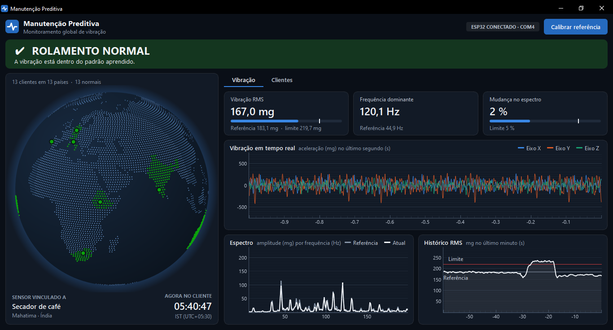
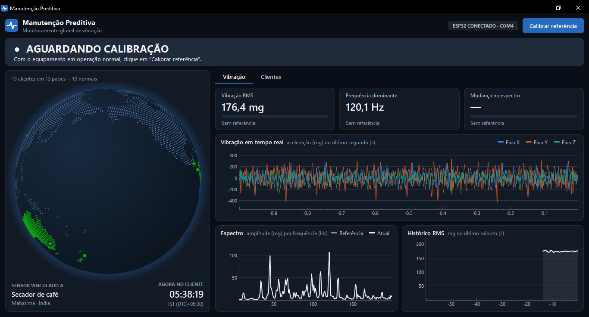
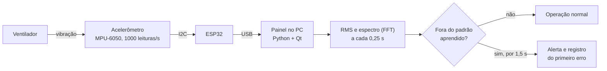

# Manutenção Preditiva com ESP32

**Protótipo que aprende a vibração normal de uma máquina e avisa quando ela muda**, antes que a
falha vire parada. Um acelerômetro preso a um ventilador mede a vibração 1000 vezes por segundo, e um
painel no computador mostra os sinais em tempo real, num globo com os clientes de uma empresa
fictícia.

-41CD52?logo=qt&logoColor=white)

## Demonstração

*Vídeo de 1 min 22 s: o ventilador em funcionamento, a troca de velocidade e o alerta aparecendo na
tela.*

## O que ele faz

- **Aprende o padrão normal.** Com a máquina funcionando bem, um clique calibra a referência em 20
  segundos.
- **Detecta a mudança.** A cada 0,25 s o programa compara a vibração com a referência e, em cerca de
  2 segundos fora do padrão, avisa **ROLAMENTO DANIFICADO**.
- **Mostra o cliente afetado.** O globo gira até o país do cliente, e a aba de clientes abre com o
  contato, o fuso horário e a data do primeiro erro.
- **Avisa mesmo minimizado.** O programa fica perto do relógio do Windows e mostra um alerta na tela
  quando algo muda.
- **Mostra a saúde do próprio sensor.** Um cartão indica se a placa responde, quantas leituras chegam
  por segundo e se a gravidade medida está perto de 1 g.

## Telas

<table>
  <tr>
    <td width="50%"></td>
    <td width="50%"></td>
  </tr>
  <tr>
    <td><b>Operação normal.</b> Sinal em tempo real dos três eixos, espectro comparado à referência e
    histórico do último minuto. O pico no histórico é o teste na velocidade 2.</td>
    <td><b>Alerta.</b> O país do cliente fica vermelho, e a página dele mostra os parâmetros do sensor
    real e a data do primeiro erro, no fuso do cliente e no fuso local.</td>
  </tr>
  <tr>
    <td></td>
    <td></td>
  </tr>
  <tr>
    <td><b>Antes da calibração.</b> O painel já mostra a vibração e espera o clique em
    <i>Calibrar referência</i>.</td>
    <td><b>Montagem.</b> O ESP32 e o acelerômetro presos à base do ventilador usado nos testes.</td>
  </tr>
</table>

*Todas as telas foram capturadas com o sensor real ligado ao ventilador.*

## Como funciona

O programa olha dois indicadores: a **energia** da vibração (RMS) e a **forma do espectro**, ou seja,
quais frequências compõem a vibração. A forma do espectro percebe uma mudança mesmo quando a máquina
não vibra mais forte. Os detalhes estão em [Como funciona](docs/como-funciona.md).

## Resultados no ventilador real

| Medida | Velocidade 1 (normal) | Velocidade 2 (simula o defeito) |
|---|---|---|
| Vibração RMS | 170 a 185 mg | 230 a 250 mg |
| Mudança no espectro | 1 % a 9 % | 19 % a 50 % |
| Condição mostrada | Rolamento normal | Rolamento danificado |

O limite aprendido na calibração ficou em cerca de 208 mg para o RMS e em 12 % para a mudança no
espectro. Veja as medições e os problemas resolvidos em [Resultados e desafios](docs/resultados.md).

## Tecnologias

| Parte | Tecnologia |
|---|---|
| Firmware | ESP32 em C++ (Arduino), leitura da fila interna do sensor a 1 kHz |
| Sensor | Acelerômetro de 3 eixos compatível com o MPU-6050, faixa de ±4 g |
| Análise | Python e NumPy: RMS, FFT com janela de Hann e limites estatísticos robustos |
| Interface | PySide6 (Qt) e pyqtgraph, com globo em projeção ortográfica desenhado pelo programa |
| Qualidade | 240 testes automatizados com pytest, incluindo uma placa imitada |

O hardware e as ligações estão em [Hardware](docs/hardware.md).

## Importante

- **O defeito é simulado.** Nenhum rolamento está danificado: a velocidade 2 do ventilador faz o
  papel do defeito, e a mensagem é uma escolha da demonstração.
- **Os clientes são fictícios.** Os 13 cadastros, como o secador de café de Mahatima, na Índia, são de
  demonstração, com telefones zerados e e-mails `example.com`. Quem vibra de verdade é o ventilador.
- **O sistema detecta desvio de padrão, não o tipo de defeito.** Uma aplicação real precisaria
  comparar leituras na mesma velocidade e validar com defeitos físicos.

## Sobre o código

O código-fonte deste projeto não está publicado. Este repositório apresenta o funcionamento, a
arquitetura e os resultados.

## Autor

**Vinicius Verdili**, projeto desenvolvido para apresentação na faculdade e no trabalho.
