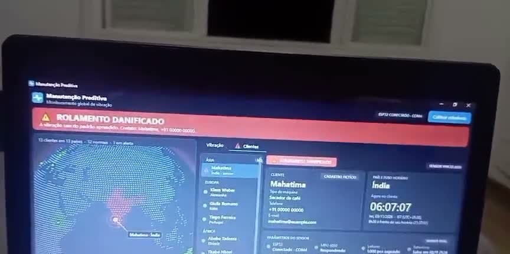
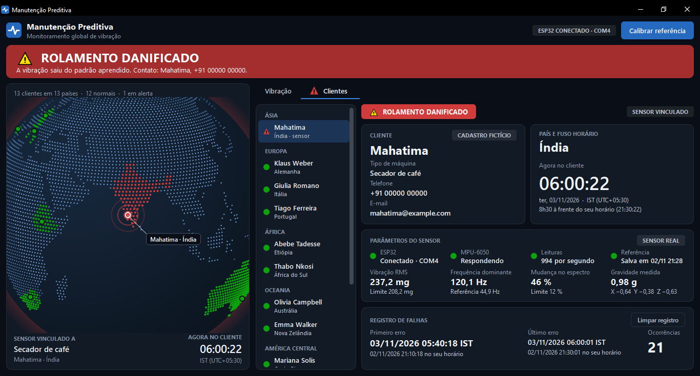
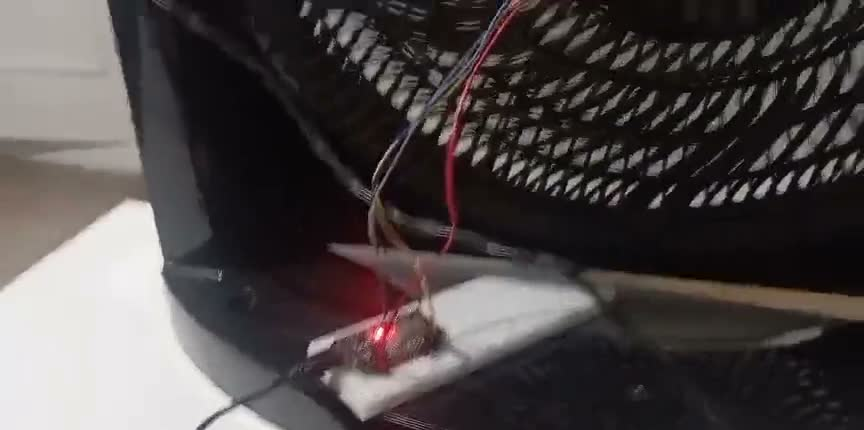
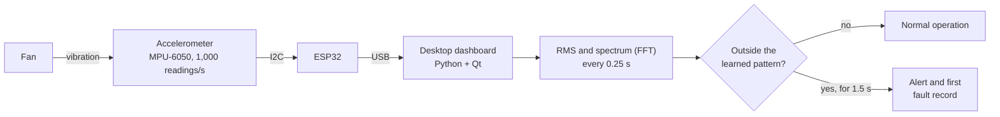

# Predictive Maintenance with ESP32

**A prototype that learns how a machine normally vibrates and warns when that changes**, before a
fault turns into downtime. An accelerometer attached to a fan measures vibration 1,000 times per
second, and a desktop dashboard shows the signals in real time on a globe with the customers of a
fictional company.

-41CD52?logo=qt&logoColor=white)

## Demo

*1 min 22 s video: the fan running, the speed change, and the alert appearing on screen. The
narration subtitles and the app interface are in Brazilian Portuguese.*

## What it does

- **Learns the normal pattern.** With the machine running well, one click calibrates the baseline in
  20 seconds.
- **Detects the change.** Every 0.25 s the software compares the vibration with the baseline, and
  after about 2 seconds outside the pattern it shows **ROLAMENTO DANIFICADO** ("bearing damaged").
- **Shows the affected customer.** The globe turns to the customer's country, and the customers tab
  opens with the contact, the time zone, and the date of the first fault.
- **Alerts even when minimized.** The app sits next to the Windows clock and pops up an alert when
  something changes.
- **Reports the sensor's own health.** A card shows whether the board responds, how many readings
  arrive per second, and whether the measured gravity is close to 1 g.

## Screens

<table>
  <tr>
    <td width="50%"></td>
    <td width="50%"></td>
  </tr>
  <tr>
    <td><b>Normal operation.</b> Real-time signal for all three axes, spectrum compared with the
    baseline, and the last minute of history. The bump in the history is the speed 2 test.</td>
    <td><b>Alert.</b> The customer's country turns red, and their page shows the real sensor's
    readings and the date of the first fault, in both the customer's and the local time zone.</td>
  </tr>
  <tr>
    <td></td>
    <td></td>
  </tr>
  <tr>
    <td><b>Before calibration.</b> The dashboard already shows the vibration and waits for a click on
    <i>Calibrar referência</i> ("calibrate baseline").</td>
    <td><b>Setup.</b> The ESP32 and the accelerometer attached to the base of the fan used in the
    tests.</td>
  </tr>
</table>

*All screens were captured with the real sensor attached to the fan.*

## How it works

The software tracks two indicators: the vibration **energy** (RMS) and the **shape of the
spectrum**, that is, which frequencies make up the vibration. The spectrum shape catches a change even
when the machine does not vibrate harder. The details are in [How it works](docs/how-it-works.md).

## Results on the real fan

| Measurement | Speed 1 (normal) | Speed 2 (stands in for the fault) |
|---|---|---|
| Vibration RMS | 170 to 185 mg | 230 to 250 mg |
| Spectrum change | 1% to 9% | 19% to 50% |
| Status shown | Normal bearing | Damaged bearing |

The baseline learned during calibration set the limits at about 208 mg for RMS and 12% for the
spectrum change. See the measurements and the problems solved in
[Results and challenges](docs/results.md).

## Technologies

| Part | Technology |
|---|---|
| Firmware | ESP32 in C++ (Arduino), reading the sensor's internal FIFO at 1 kHz |
| Sensor | 3-axis accelerometer compatible with the MPU-6050, ±4 g range |
| Analysis | Python and NumPy: RMS, Hann-windowed FFT, and robust statistical limits |
| Interface | PySide6 (Qt) and pyqtgraph, with a globe rendered in orthographic projection by the app |
| Quality | 240 automated tests with pytest, including a simulated board |

The hardware and wiring are in [Hardware](docs/hardware.md).

## Important notes

- **The fault is simulated.** No bearing is damaged: the fan's speed 2 plays the role of the fault,
  and the message is a choice made for the demo.
- **The customers are fictional.** The 13 entries, such as Mahatima's coffee dryer in India, are for
  demonstration only, with zeroed phone numbers and `example.com` emails. The fan is the only thing
  actually vibrating.
- **The system detects a deviation from the pattern, not the type of fault.** A real application
  would need to compare readings at the same speed and validate them against physical faults.

## About the code

The source code for this project is not published. This repository presents how it works, its
architecture, and its results.

## Author

**Vinicius Verdili**, a project built for presentations at college and at work.
