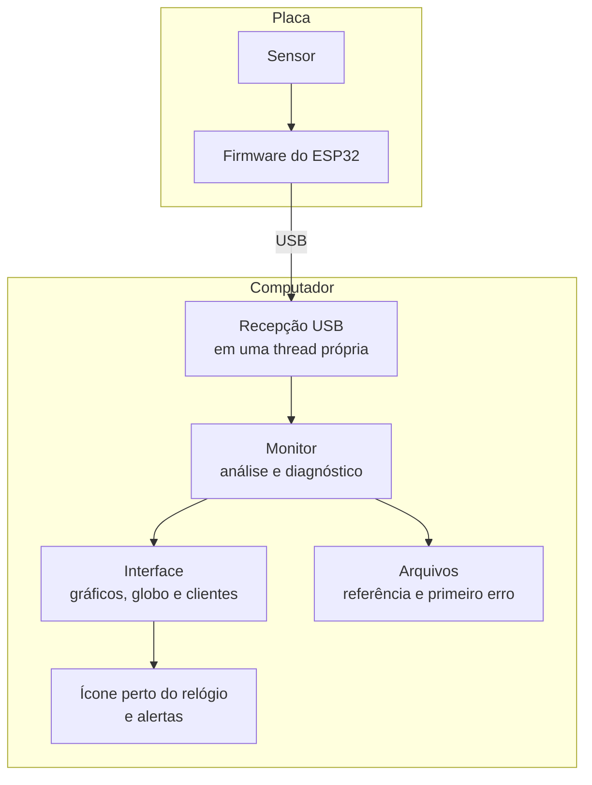

# Como funciona

[Voltar ao início](../README.md)

## Do sensor à tela

1. **Medição.** O acelerômetro mede os três eixos 1000 vezes por segundo e guarda as amostras na
   própria fila interna. O relógio do sensor dita o ritmo, então atrasos na comunicação não distorcem
   a taxa de amostragem.
2. **Envio.** O ESP32 lê a fila em lotes de 20 amostras e envia pela USB. Ele confere cada lote antes
   de enviar e descarta leituras corrompidas.
3. **Análise.** A cada 0,25 s, o programa analisa o último segundo de sinal: calcula o RMS e o
   espectro de 5 a 200 Hz com uma FFT.
4. **Diagnóstico.** Os dois indicadores são comparados com a referência aprendida na calibração.
5. **Apresentação.** O painel atualiza os gráficos, o globo e a página do cliente, e grava a data do
   primeiro erro em arquivo.

## Os dois indicadores

| Indicador | O que mede | Por que importa |
|---|---|---|
| **RMS** | A energia total da vibração | Percebe a máquina vibrando mais forte |
| **Mudança no espectro** | O quanto a forma do espectro difere da referência, de 0 % (igual) a 100 % | Percebe uma vibração diferente mesmo com a mesma energia |

A mudança no espectro compara só a forma, sem levar em conta a intensidade. Um rolamento gasto pode
criar novas frequências antes de aumentar a vibração total.

## Calibração

Durante 20 segundos, com a máquina funcionando bem, o programa mede 80 janelas de análise e aprende:

- o RMS típico e a sua variação;
- o espectro típico;
- a variação normal da forma do espectro.

Os limites são a **mediana mais cinco desvios**, com uma margem mínima de 20 % no RMS e de 12 % no
espectro. Com a mediana, algumas leituras ruins durante a calibração não estragam a referência. A
referência fica salva em cada cliente e volta ao abrir o programa.

## Decisão

Uma janela só conta como anormal se passar do limite. Para evitar alarmes por batidas isoladas, a
condição só muda depois de 6 janelas seguidas fora do padrão, cerca de 1,5 s. A volta ao normal pede
8 janelas seguidas.

| Condição | Quando aparece |
|---|---|
| Aguardando calibração | Ainda não há referência |
| Rolamento normal | Os indicadores estão dentro dos limites |
| Rolamento danificado | O RMS **ou** a forma do espectro saíram do padrão |
| Máquina parada | A vibração caiu abaixo de 40 % da referência |
| Sem dados do sensor | A placa ou o sensor não respondem, e a tela diz o motivo |

## Arquitetura

A análise não depende da interface: a mesma lógica roda nos testes automatizados, com um simulador
de ventilador e uma placa imitada, sem nenhum hardware ligado.
