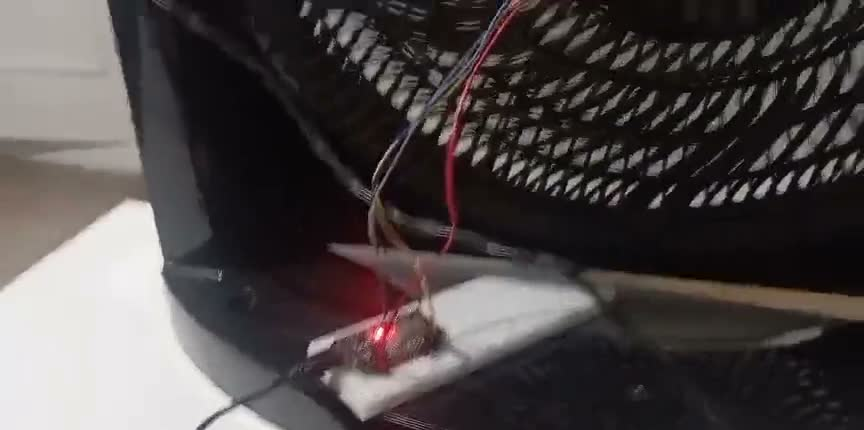

# Hardware

[Back to the main page](../README.md)

## Parts

| Item | Purpose |
|---|---|
| ESP32 WROOM-32, 30-pin board | Reads the sensor and sends the data over USB |
| GY-521 module, MPU-6050 compatible | 3-axis accelerometer |
| Micro USB data cable | Power and communication with the computer |
| Jumper wires and soldered sensor header | Connections |
| Arno Turbo Silêncio Maxx fan | The monitored machine |

## Wiring

| Sensor | ESP32 |
|---|---|
| VCC | 3V3 |
| GND | GND |
| SCL | D22 (GPIO22) |
| SDA | D21 (GPIO21) |

The sensor is attached to the rigid part closest to the motor. The ESP32 stays outside the fan, and
only the sensor goes on it.

## Sensor configuration

| Parameter | Value |
|---|---|
| Sampling rate | 1,000 readings per second |
| Range | ±4 g (8,192 counts per g) |
| Internal filter | Low-pass, with analysis up to 200 Hz |
| Communication | I2C at 400 kHz, USB at 921,600 bps |
