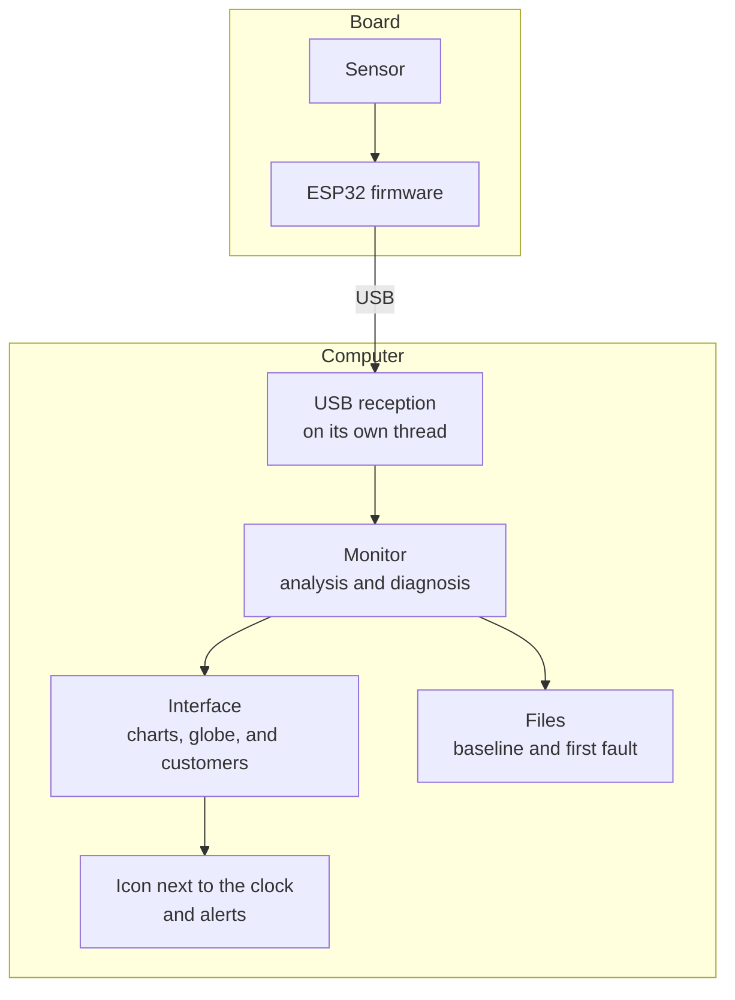

# How it works

[Back to the main page](../README.md)

## From the sensor to the screen

1. **Measurement.** The accelerometer samples all three axes 1,000 times per second and stores the
   samples in its own internal FIFO. The sensor's clock sets the pace, so communication delays do not
   distort the sampling rate.
2. **Transfer.** The ESP32 reads the FIFO in batches of 20 samples and sends them over USB. It checks
   each batch before sending and discards corrupted readings.
3. **Analysis.** Every 0.25 s, the software analyzes the last second of signal: it computes the RMS
   and the 5 to 200 Hz spectrum with an FFT.
4. **Diagnosis.** Both indicators are compared with the baseline learned during calibration.
5. **Display.** The dashboard updates the charts, the globe, and the customer page, and saves the
   date of the first fault to a file.

## The two indicators

| Indicator | What it measures | Why it matters |
|---|---|---|
| **RMS** | The total energy of the vibration | Catches the machine vibrating harder |
| **Spectrum change** | How much the spectrum's shape differs from the baseline, from 0% (identical) to 100% | Catches a different vibration even at the same energy |

The spectrum change compares shape only, regardless of intensity. A worn bearing can create new
frequencies before the overall vibration increases.

## Calibration

For 20 seconds, with the machine running well, the software measures 80 analysis windows and learns:

- the typical RMS and its variation;
- the typical spectrum;
- the normal variation of the spectrum's shape.

The limits are the **median plus five deviations**, with a minimum margin of 20% for RMS and 12% for
the spectrum. Using the median keeps a few bad readings during calibration from ruining the
baseline. The baseline is saved per customer and restored when the app opens.

## Decision

A window only counts as abnormal if it exceeds a limit. To avoid alarms from isolated bumps, the
status only changes after 6 consecutive windows outside the pattern, about 1.5 s. Returning to normal
takes 8 consecutive windows.

| Status | When it appears |
|---|---|
| Waiting for calibration | There is no baseline yet |
| Normal bearing | Both indicators are within their limits |
| Damaged bearing | The RMS **or** the spectrum's shape left the pattern |
| Machine stopped | The vibration dropped below 40% of the baseline |
| No sensor data | The board or the sensor is not responding, and the screen says why |

## Architecture

The analysis does not depend on the interface: the same logic runs in the automated tests, with a
fan simulator and a simulated board, with no hardware connected.
